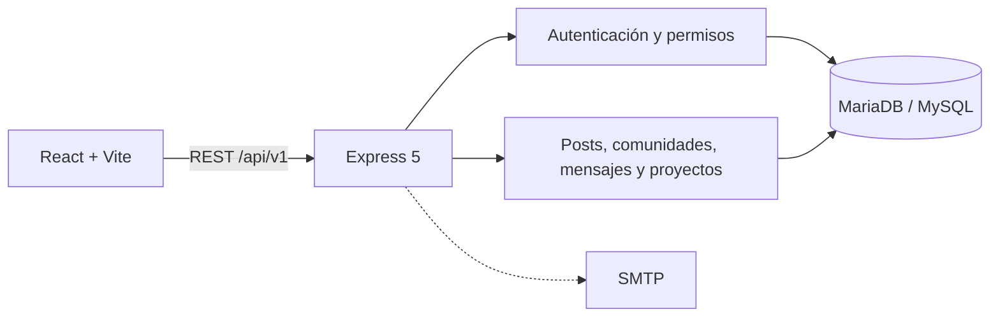

# Nexo

Una red social full stack para compartir ideas, crear comunidades, conversar y publicar proyectos. Nexo combina una interfaz editorial experimental con una API REST modular, sesiones revocables y reglas de privacidad aplicadas desde la base de datos hasta la respuesta HTTP.


## Qué demuestra este proyecto

- Producto completo en React 19, TypeScript, Express 5 y MariaDB/MySQL.
- Identidad visual propia, temas claro/oscuro y diseño responsive desde 320 px.
- Registro, login, logout, recuperación de cuenta y verificación de correo.
- Sesiones JWT almacenadas en cookies HttpOnly y revocadas en la base de datos.
- Perfiles, seguidores, publicaciones, comentarios, reacciones y guardados.
- Comunidades públicas/privadas con roles de propietario, moderador y miembro.
- Mensajes directos, respuestas, edición, borrado y estado de lectura.
- Proyectos con borradores, publicación, archivo y visibilidad por seguidores.
- Estados de carga, vacío y error; navegación por teclado y movimiento reducido.
- OpenAPI generado, migraciones con checksum y pruebas unitarias, HTTP y de navegador.

## Arquitectura



```text
frontend/                  aplicación React, estilos y pruebas Playwright
backend/src/               API modular, middleware y lógica de negocio
backend/database/          esquema inicial y migraciones incrementales
backend/contracts/         contrato OpenAPI generado
backend/tests/             pruebas unitarias e integración HTTP/MySQL
docs/                      arquitectura, decisiones y material visual
```

La API separa rutas, validación, servicios y repositorios. Las consultas usan parámetros, las mutaciones sensibles se ejecutan en transacciones y las colecciones se paginan con cursores ligados a sus filtros.

## Stack

| Capa      | Tecnologías                                                      |
| --------- | ---------------------------------------------------------------- |
| Frontend  | React 19, TypeScript, Vite, React Router, CSS Modules, GSAP      |
| Backend   | Node.js 20+, Express 5, TypeScript, Zod, mysql2                  |
| Datos     | MariaDB 10.4+ / MySQL, migraciones SQL, integridad referencial   |
| Seguridad | Helmet, CORS estricto, CSRF, rate limiting, scrypt, JWT HttpOnly |
| Calidad   | ESLint, Prettier, Playwright, Node Test Runner, OpenAPI          |

## Puesta en marcha

Requisitos: Node.js 20 o superior, npm y MariaDB/MySQL. La configuración local documentada usa MySQL de XAMPP en `127.0.0.1:3307`.

```bash
git clone <URL_DEL_REPOSITORIO>
cd nexo-social
npm run install:all
```

Copiar la plantilla local y completar valores propios. El archivo resultante está ignorado por Git.

```powershell
Copy-Item backend/.env.example backend/.env
```

Generar un secreto de sesión:

```bash
node -e "console.log(require('node:crypto').randomBytes(48).toString('hex'))"
```

Para una base nueva, configurar temporalmente una cuenta con permisos DDL, crear el esquema y aplicar migraciones:

```bash
npm run db:apply
npm run db:migrate -- --apply
npm run db:verify
```

El usuario usado por la API debe limitarse a `SELECT`, `INSERT`, `UPDATE` y `DELETE`. Las credenciales administrativas solo se usan al aplicar migraciones.

Iniciar ambos procesos en terminales distintas:

```bash
npm run dev:backend
npm run dev:frontend
```

- Frontend: `http://127.0.0.1:5173`
- API: `http://127.0.0.1:3000/api/v1`
- Health: `GET /api/v1/health`
- Readiness: `GET /api/v1/health/ready`

## Variables de entorno

La lista completa y valores seguros de ejemplo están en [`backend/.env.example`](backend/.env.example).

| Variable                        | Uso                                                |
| ------------------------------- | -------------------------------------------------- |
| `DB_HOST`, `DB_PORT`, `DB_NAME` | Conexión con la base                               |
| `DB_USER`, `DB_PASSWORD`        | Cuenta restringida de ejecución                    |
| `JWT_SECRET`                    | Firma de sesiones; mínimo 32 bytes                 |
| `HOST`, `PORT`                  | Interfaz y puerto de la API                        |
| `FRONTEND_ORIGIN`               | Origen exacto permitido por CORS                   |
| `SMTP_*`, `MAIL_FROM`           | Recuperación y verificación de cuenta              |
| `MIGRATION_DB_*`                | Credenciales administrativas solo para migraciones |

Nunca se deben versionar `.env`, certificados, tokens, dumps o credenciales. El [`.gitignore`](.gitignore) incluye estos casos y conserva únicamente las plantillas `.env.example`.

## Comandos de calidad

```bash
npm run typecheck          # TypeScript de ambos paquetes
npm run build              # build de producción del frontend
npm run test               # Playwright + pruebas del backend
npm run format:check       # formato de ambos paquetes
npm run check              # validación integral
npm --prefix backend run api:check
npm audit
```

Las pruebas de integración del backend requieren una base local preparada. Crean usuarios con identificadores aleatorios y eliminan únicamente esos datos al finalizar.

## Seguridad y decisiones de producción

- Cookies `HttpOnly`, `SameSite=Lax` y `Secure` en producción.
- CORS de origen único y cabecera CSRF obligatoria para mutaciones.
- Contraseñas derivadas con `scrypt`, sal aleatoria y comparación constante.
- JWT con algoritmo, emisor, audiencia, vencimiento y `jti` verificados.
- Sesiones persistidas y revocables; cambiar la contraseña invalida todas.
- Tokens de recuperación/verificación almacenados como SHA-256 y de un solo uso.
- Respuestas de recuperación indistinguibles para evitar enumerar cuentas.
- Validación estricta de payloads, límite de 128 KB y errores sin detalles internos.
- Consultas SQL parametrizadas, transacciones y comprobaciones de autorización.

Para una instalación pública todavía se necesita infraestructura externa: HTTPS, SMTP autenticado, backups, observabilidad, almacenamiento de archivos, límites distribuidos y una política operativa de secretos.

## Documentación

- [Backend y endpoints](backend/README.md)
- [Arquitectura del backend](BACKEND_ARCHITECTURE.md)
- [Esquema y migraciones](backend/database/README.md)
- [Contrato OpenAPI](backend/contracts/openapi.json)
- [Frontend](frontend/README.md)

## Estado

El núcleo social, autenticación, permisos, persistencia y frontend están conectados. El proyecto no incluye datos mock en producción. Las respuestas simuladas viven exclusivamente en las pruebas de navegador.
